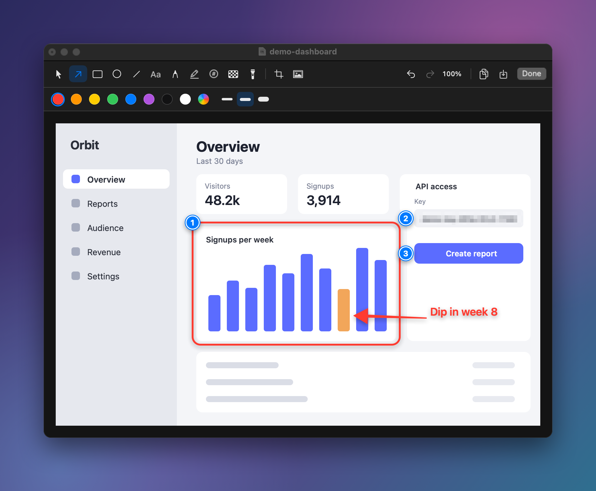
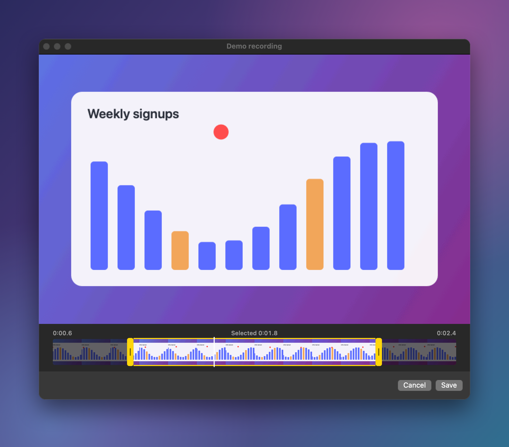
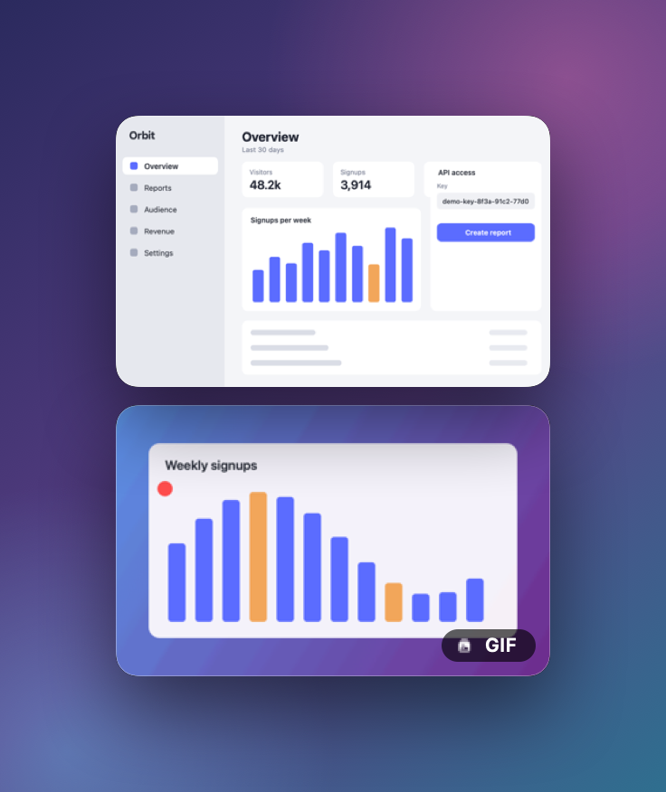
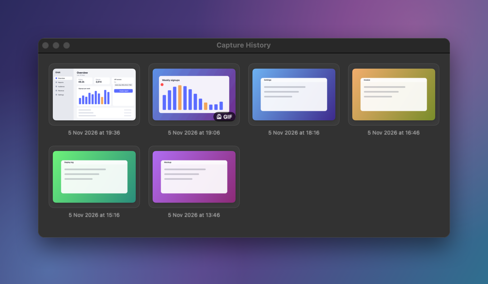
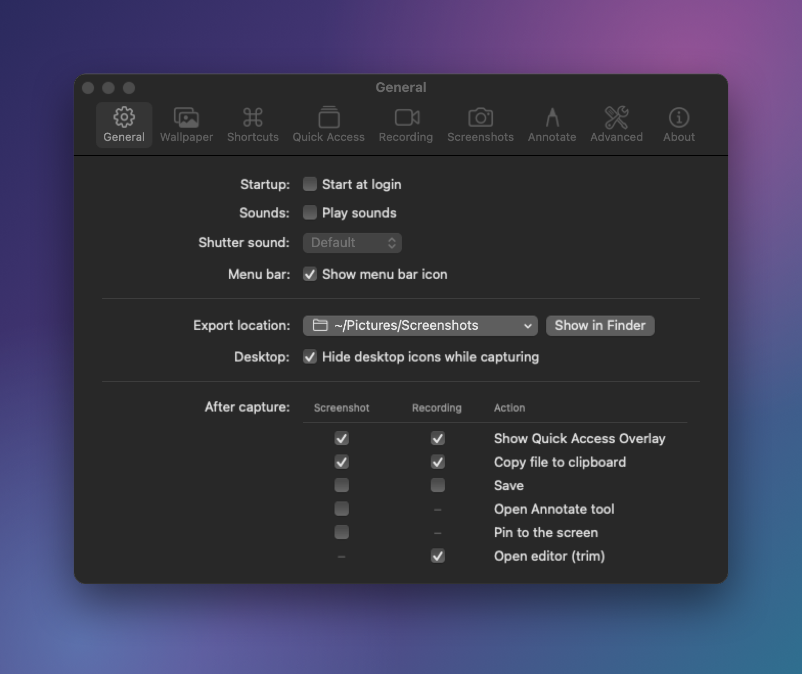

# Snapframe

Menu bar app for screenshots and screen recordings on macOS 15+ (Apple Silicon and Intel).



## Features

- Capture area (crosshair, magnifier, freeze screen), previous area, window (wallpaper background,
  padding, shadow; hold ⇧ for transparent, ⌥ for no shadow), fullscreen, self-timer
- Capture text (OCR) to the clipboard
- Quick Access overlay: stacked thumbnails on the active screen with Copy, Save, Annotate, Pin,
  drag and drop, auto-close
- Annotation editor: arrow, line, rectangle, ellipse, text, pencil, highlighter, numbered steps,
  pixelate, blur, spotlight, crop, background tool with presets, undo/redo
- Pin screenshots above all windows
- Screen recording to MP4 (H.264/HEVC) or GIF: microphone and system audio, pause/resume,
  controls, dimmed surroundings, click highlights, keystrokes, countdown, trim editor
- Capture history, hide desktop icons, global shortcuts, URL scheme (`snapframe://capture-area` etc.,
  off by default)

## Screenshots

**Trim editor.** Opens after every recording. Drag the handles to trim a video or GIF; GIFs are trimmed
without re-encoding.



**Quick Access.** Every capture lands as a thumbnail on the active screen, ready to copy, save, annotate,
pin or drag into another app.



**Capture history.** Earlier screenshots and recordings, with one-click editing.



**Settings.** What happens after a capture, per screenshot and per recording.



## Default shortcuts

| Action | Shortcut |
|---|---|
| Capture Fullscreen | ⌥⇧⌘3 |
| Capture Area | ⌥⇧⌘4 |
| Capture Window | ⌥⇧⌘5 |
| Capture Previous Area | ⌥⇧⌘6 |
| Record Screen | ⌥⇧⌘7 |
| Capture Text | ⌥⇧⌘8 |
| Self-Timer | ⌥⇧⌘9 |

To use ⇧⌘3/4/5 instead, turn the macOS screenshot shortcuts off in System Settings › Keyboard ›
Keyboard Shortcuts › Screenshots, then record them in Snapframe › Settings › Shortcuts.

## Install

1. Unzip `Snapframe.zip` and move `Snapframe.app` to `/Applications`.
2. The app is not notarized. On first launch macOS blocks it: open System Settings › Privacy & Security and
   click **Open Anyway**, or run `xattr -dr com.apple.quarantine /Applications/Snapframe.app`.
3. Grant **Screen & System Audio Recording** when asked (System Settings › Privacy & Security). Optional:
   **Microphone** (recording with mic) and **Accessibility** (showing keystrokes in recordings).

macOS ties these permissions to the app's code signature. Builds signed with the same stable identity keep
them across updates; ad-hoc signed builds (the default when building from source) are asked again after each
rebuild.

## Updates

Updates are optional and self-hosted. A build made with `SNAPFRAME_UPDATE_URL` (see Build) checks that feed
30 seconds after launch and daily; **Check for Updates…** in the menu and
the About tab does it on demand. An update is installed only if its SHA-256 matches the feed and its signature
satisfies this copy's own requirement (same bundle id and signing certificate). Ad-hoc signed copies can't verify
updates and must be replaced by hand. Builds without a feed URL (including every `--public` build) have no
updater at all: no menu item, no background checks, no network requests.

If the user can't write to Snapframe's folder (a standard account with Snapframe in `/Applications`, owned by
root:admin), the update runs everything up to the signature check as you, then asks macOS for an administrator's
name and password once. One privileged script copies the verified app into a root-created private folder next to
the installed one, makes it root-owned, re-checks its signature, bundle id and version as root against this app's
own requirement, checks the installed copy the same way, and swaps it in (rename the old bundle aside, rename the
new one in, delete the old; the old one goes back if the second rename fails). Only the literal
`/Applications/Snapframe.app`, and not a symlink, is ever replaced this way. Cancelling the password prompt
cancels the update. A copy running from a quarantined Downloads location asks to be moved to Applications first.

## Troubleshooting

- **Freezes at launch / "not responding" / "Open Anyway" does nothing:** security software that vets every
  program launch (for example a VPN client's threat protection) can hold a new, unknown app before it
  starts. Add Snapframe as an exception there, or turn the protection off for the first launch.

## Build

Requires the Xcode Command Line Tools (Swift 6.x); Xcode itself is not needed.

```sh
scripts/build-app.sh            # universal dist/Snapframe.app + dist/Snapframe.zip
scripts/build-app.sh --native   # host architecture only, faster
scripts/build-app.sh --public   # ignore local build settings: ad-hoc signature, no update feed
swift run SnapframeSelfTest     # test suite (optionally pass a name filter)
swift scripts/make-icon.swift   # regenerate Resources/AppIcon.icns
swift run SnapframeScreenshots  # re-render the README screenshots into assets/readme/
```

Optional build settings come from the environment or from `~/.config/snapframe/build.env` (sourced by the build
script, never part of the repo): `SNAPFRAME_SIGN_IDENTITY` (plus `SNAPFRAME_SIGN_KEYCHAIN` and
`SNAPFRAME_SIGN_KEYCHAIN_PASSWORD` if the identity lives in its own keychain) for a stable signature, and
`SNAPFRAME_UPDATE_URL` for a self-hosted update feed published with `scripts/publish-update.sh`.

## License

MIT, see [LICENSE](LICENSE).
